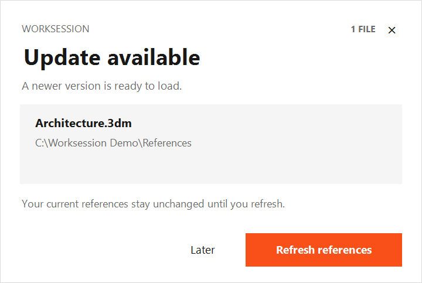
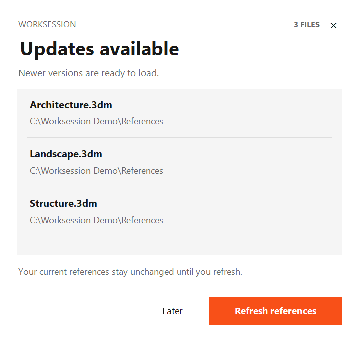

# Worksession Notifier

## Installation Guide · v0.2.2-beta.1

Receive an English popup when a file attached to your Rhino Worksession changes on disk. The Worksession panel does not need to be open.



### Requirements

- Windows and **Rhino 8 running .NET 8**.
- Tested with Rhino 8.35. Plugin version: **0.2.2-beta.1**.

### Installation

1. Obtain [WorksessionNotifier.rhp](dist/WorksessionNotifier.rhp).
2. Paste this path into the File Explorer address bar:

   ```text
   %APPDATA%\McNeel\Rhinoceros\8.0\Plug-ins
   ```

3. Create a **WorksessionNotifier** folder there and place the `.rhp` file inside it.
4. **Drag that file from its folder into the Rhino window.** Copying the file into the folder alone does not register it.
5. Run **WSNotifyStatus** in Rhino. Confirm that **Enabled=True**.
6. If monitoring is disabled, run **WSNotifyOn**.

The plugin loads automatically when Rhino starts. Your on/off preference is retained between sessions.

**Keep the installed file in place.** Drag-and-drop installation registers its location; it does not copy the file elsewhere. Do not move or delete it after installation.

<!-- pagebreak -->

## Commands and Notifications

### Rhino commands

| Command | Function |
|---|---|
| `WSNotifyStatus` | Shows whether monitoring is enabled, watched files, pending changes, and file-access errors. |
| `WSNotifyOn` | Enables monitoring and establishes a new baseline. Clears existing pending notification state. |
| `WSNotifyOff` | Disables monitoring, hides the popup, and clears pending notification state. |
| `WSNotifyShow` | Reopens pending notifications dismissed with Later or ×. No popup appears if there are no pending changes. |

### Popup buttons

| Button | Action |
|---|---|
| **Refresh references** | Refreshes changed references throughout the current Worksession, not just the files shown in the popup. Waits until any running Rhino command finishes. |
| **Later / ×** | Dismisses the popup without refreshing. The pending change is retained. The same saved version does not notify again; another saved change produces a new alert. |



Hover over a file to see its full path. Scroll the list for additional files. Drag the title area to reposition the popup. A manual refresh through Worksession also clears the corresponding pending alert.

<!-- pagebreak -->

## Updates and Troubleshooting

### Updating the plugin

1. Save your work and **close all Rhino instances**.
2. Replace the installed **WorksessionNotifier.rhp** with the new version.
3. Restart Rhino and run **WSNotifyStatus**.

Replacing the file at the same path does not require registering it again. If you move it, drag the file from its new location into Rhino to register that location.

### Reading the status

| Field | Meaning |
|---|---|
| `Enabled=True / False` | Monitoring is on / off. |
| `Monitored` | Number of watched reference files; excludes the active file you are editing. |
| `Pending` | Number of detected file changes not yet acknowledged by a refresh. |
| `Watching / Changed` | Watched file path / path with a detected change. |
| `Unavailable` | Missing or inaccessible file path and its error. |

### If no notification appears

1. Check **Enabled=True** with **WSNotifyStatus**.
2. If **Monitored=0**, confirm that reference files are attached to the Worksession.
3. For **Unavailable** entries, check the path, network connection, and permissions.
4. Confirm that the original file was saved and any cloud sync has finished locally.
5. Finish the current Rhino command and allow time for the next check.
6. Use **WSNotifyShow** for a change already dismissed with Later.

If Rhino does not recognize the commands, drag the installed `.rhp` into Rhino again and check the command history for loading errors.

### Timing and detection limits

The plugin checks file timestamps and sizes about every **15 seconds** and waits for stable observations. Alerts normally appear **15–30 seconds** after a saved change becomes visible on your PC. Network delays and running Rhino commands can increase this time.

Changes made before monitoring starts are not reported. Cloud files are detected after local synchronization. This detects saved-file changes, not geometry differences; changes preserving both timestamp and size may be missed. Missing files and access errors are listed in **WSNotifyStatus**, rather than shown as update popups.

To test, attach a reference and allow the baseline to be established. Save a change to that reference from another Rhino instance, wait for the popup, and click **Refresh references** to verify the updated geometry.
